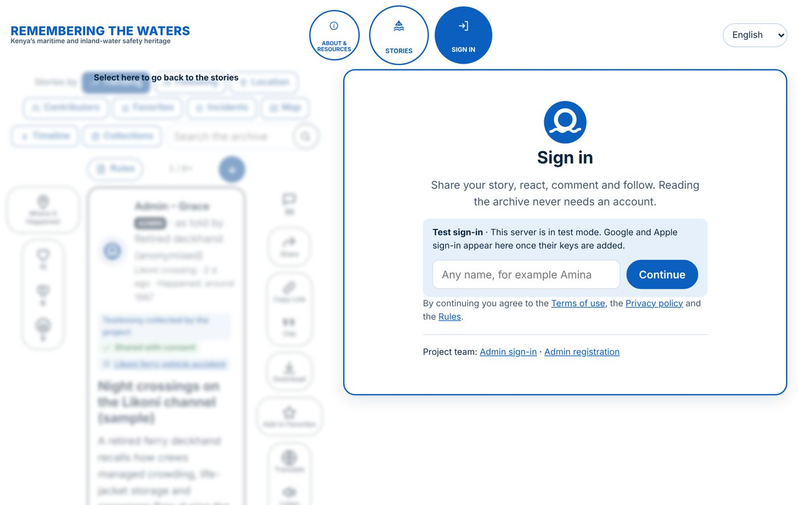
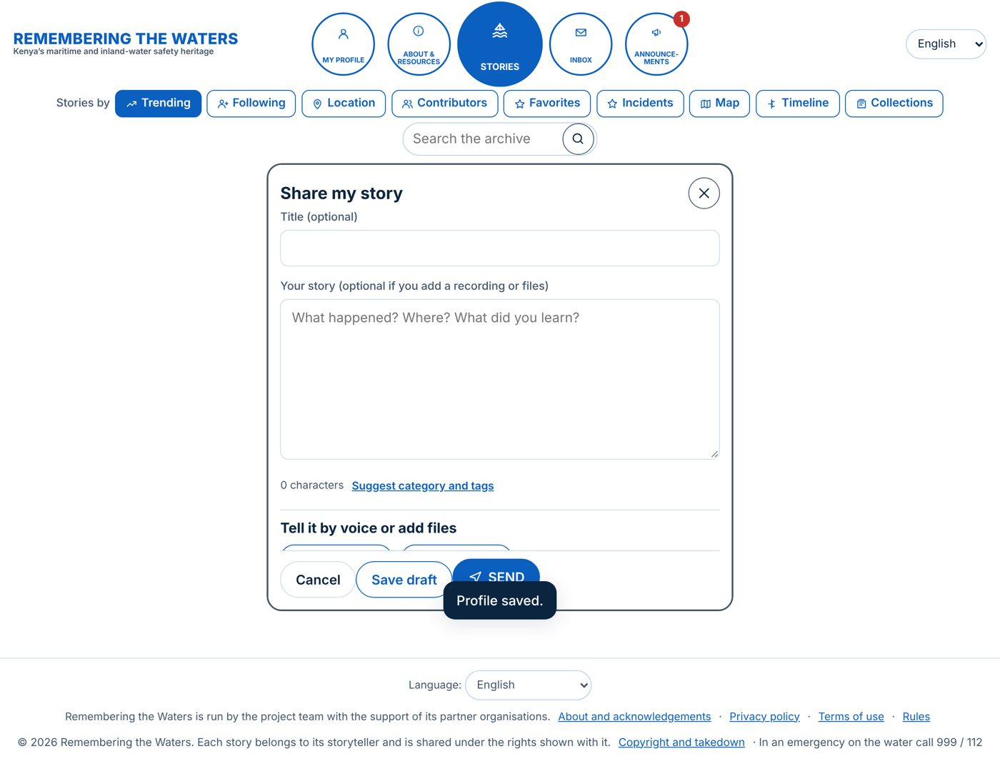
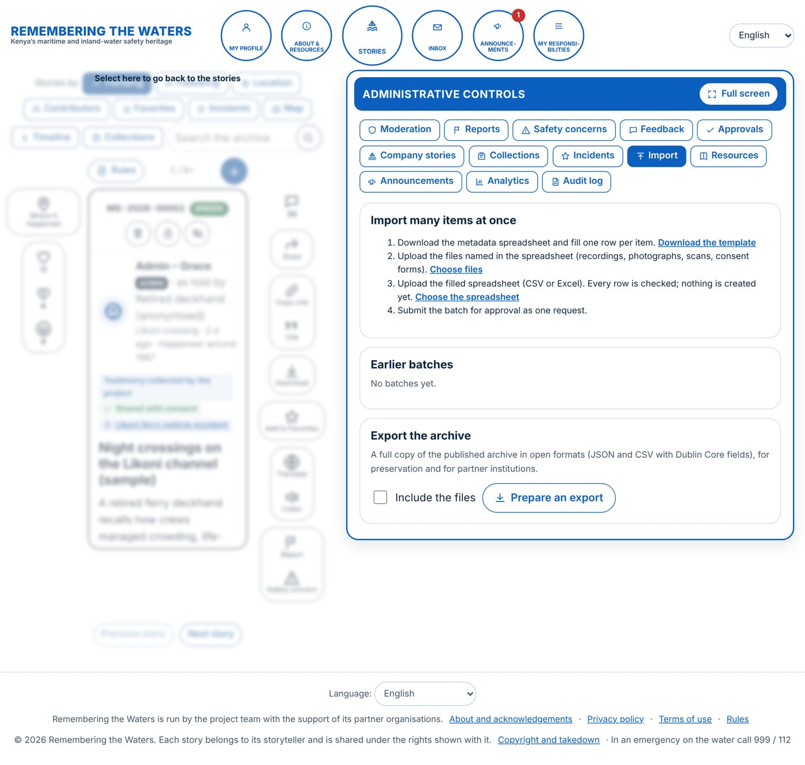
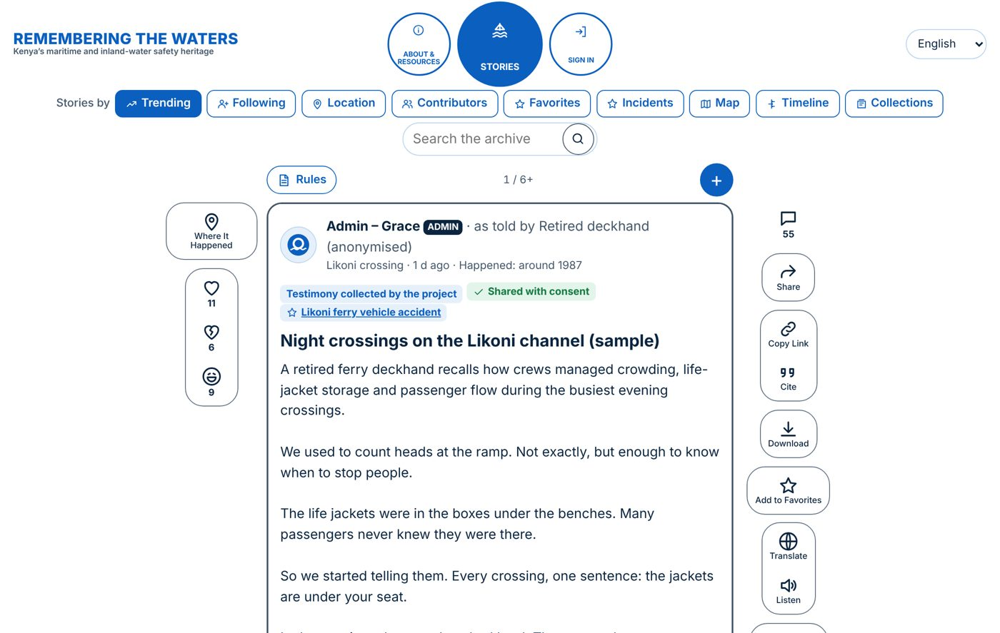
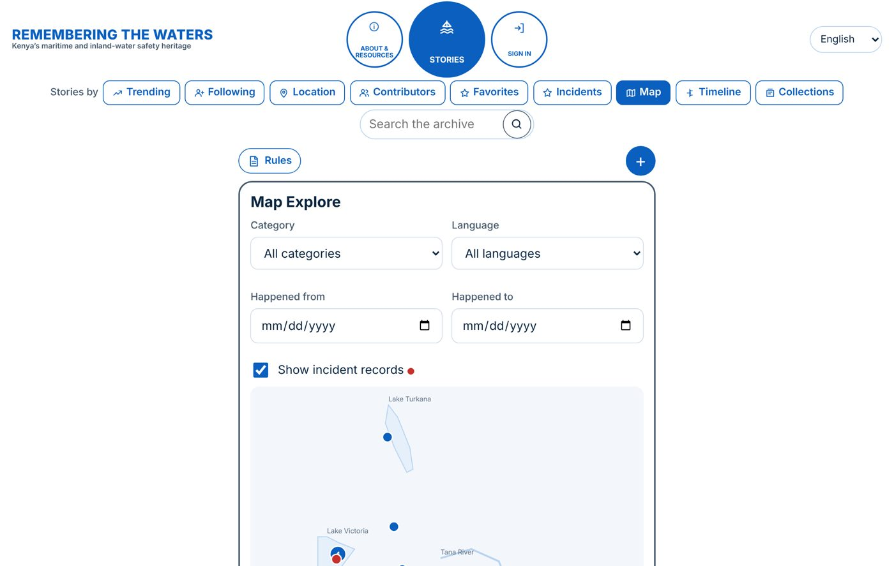
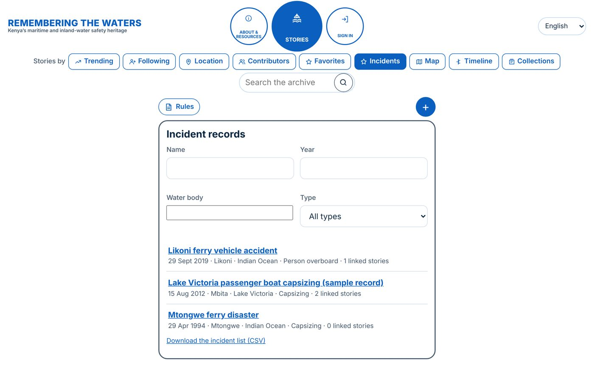
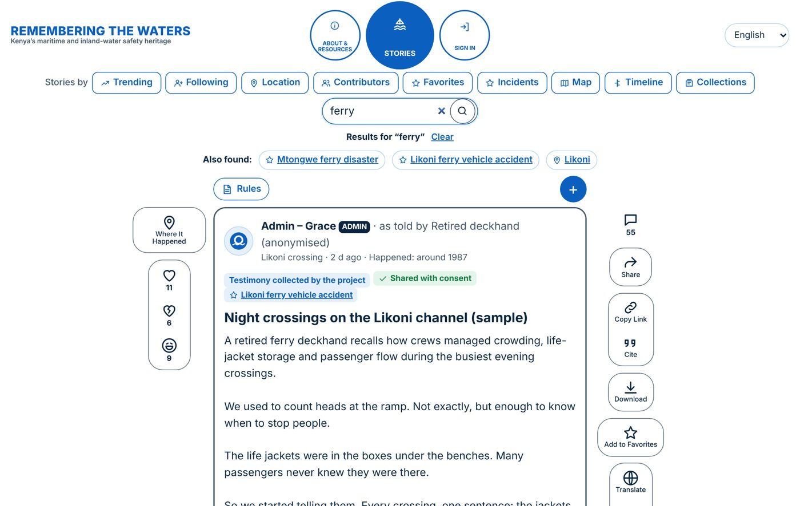
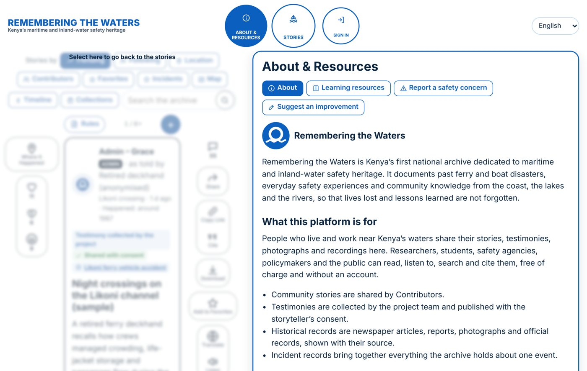
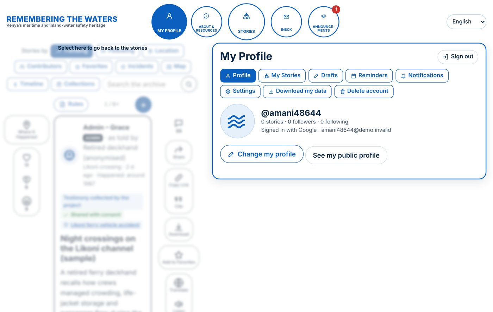

# Handbook: documenting stories, uploading materials and using the archive

For the project's partners, researchers and community representatives who collect and add material to **Remembering the Waters**. It has three parts:

1. [How to document a story](#part-1-how-to-document-a-story): consent, recording and describing.
2. [How to upload materials](#part-2-how-to-upload-materials): one story at a time, or many at once.
3. [Navigation and use of the digital archive](#part-3-navigation-and-use-of-the-digital-archive).

The screenshots show the website on the test site, with sample stories (27 November 2026). The app looks the same on a phone. At go-live an admin publishes this handbook in **ABOUT & RESOURCES › Learning resources**.

> **In an emergency on the water, call 999 or 112.** The archive is not an emergency service.

## Part 1: How to document a story

### Before you record: consent

Nothing is published without the storyteller's agreement.

- Explain in the storyteller's own language what the archive is, that it is public and free to read, and that their story may be read, heard, shared and cited by anyone.
- Ask how they wish to be named: by name, or **anonymously**. A narrator who wishes to remain anonymous is published anonymously; only the project team sees who they are.
- Ask whether others may **download** their recording or photographs.
- Record the consent: a **signed form**, or **recorded verbal consent** at the start of the recording (“My name is …, today is …, and I agree to …”). Note the **date**.
- For anyone under 18, a **parent or guardian** must agree and be named. Pictures or stories that identify a child need that agreement too.
- Tell them they can **withdraw** at any time. An admin then removes the story from public view at once.
- Before publication the project returns to the storyteller, in its feedback and validation meetings, to confirm **how their contribution is represented**. Only then is the testimony marked as validated and published.

### Stories about loss

Many stories are about drownings, accidents and disasters. They belong in the archive.

- Let the storyteller set the pace and stop when they wish.
- Do not photograph or film injured or dead people. Graphic images are not published.
- Do not record other people's phone numbers, addresses or ID numbers.
- When you add the story, mark it as **describing loss of life or possibly distressing**, so readers see a notice first.
- For a recent incident or a missing person, check with the project team first, so that the story does not interfere with an official search or investigation.

### Recording guidance

The platform accepts common phone formats. These settings give good results without files that are too large to send.

| | Use | Avoid | Size limit per file |
|---|---|---|---|
| **Audio** | A phone's voice recorder or the archive's own **Record audio** button; MP3, M4A or WAV. Hold the phone 20–30 cm from the speaker, in a quiet place out of the wind | Recording beside engines, generators or a radio | 100 MB, one per story |
| **Video** | Phone camera held sideways (landscape), 720p or 1080p, MP4. Light on the speaker's face, not behind them | 4K (files become too large); long single takes | 200 MB and 5 minutes, one per story |
| **Photographs** | JPEG or PNG at the camera's normal quality. For old photographs, photograph or scan them flat, in even light, without flash glare | Screenshots of photographs; photos of a screen | 25 MB, up to 20 per story |
| **Documents** | PDF. Scan at 300 dpi; one PDF per document | Photos of pages at an angle | 25 MB, up to 4 per story |

A longer interview is best cut into parts of up to 5 minutes for video, each added as its own story and linked to the same incident or collection. Audio can be longer within the 100 MB limit.

**Check before you leave:** play back the first minute. Is the voice clear? Did the recording save?

**Keep the originals.** The archive keeps the file you upload unchanged for preservation, but keep your own copy until the project confirms the item is published.

### Naming your files

Use names that say what the file is, with no spaces or special characters:

`place-kind-number.extension` — for example `likoni-interview-01.mp3`, `likoni-photo-01.jpg`, `likoni-consent-01.pdf`.

In a bulk upload the names in the spreadsheet must match the file names exactly.

### What to write down for every item

Fill these in while you are still with the storyteller. They are the columns of the metadata spreadsheet ([METADATA.md](METADATA.md)).

| Write down | Example |
|---|---|
| Title | Night crossings on the Likoni channel |
| Who told or created it, and whether to publish their name | Retired deckhand; anonymous |
| When it happened (a date, or a year marked approximate) | 1987, approximate |
| Where it happened | Likoni |
| The incident it belongs to, if any | Mtongwe ferry disaster |
| Language | Kiswahili (`sw`) |
| Category and a few tags | Ferry and passenger transport; ferry, crew |
| Vessel, if any | |
| Type and date of consent; file name of the consent form | Signed form, 14 March 2026, `likoni-consent-01.pdf` |
| Whether downloads are allowed | Yes |
| Usage rights | CC BY-NC 4.0 |
| For a historical record: the holding institution or publication, its reference, original date, creator, rights, and how it was obtained | |

## Part 2: How to upload materials

There are two ways. A Contributor adds one story at a time. The project team (admins) can add many at once.

### One story at a time

1. **Sign in** with Google or Apple. The first time, choose a username and picture.

   

2. Select the **+** on the STORIES page (**Share my story**).
3. Choose **Whose story is this?**: your own, or **as told by another person**. For another person's story, confirm that they have agreed.
4. Type the story, or **tell it by voice or add files**. You can record audio or video on the spot.
5. Fill in **Story details**: category and tags, language, when and where it happened, the vessel, and the linked incident.
6. Under **Options**, choose how to post (by name or anonymously), the usage rights, whether to allow downloads, and whether to mark the story as distressing.
7. **SEND**. Or **Save draft** and finish later from **MY PROFILE › Drafts**.

*The **Share my story** form.*

The story is checked automatically, usually within seconds and at most 3 minutes, and you are told the result. If the connection drops, large files continue from where they stopped, and an unfinished story is kept on your device.

### Many items at once (project team)

Admins use **ADMINISTRATIVE CONTROLS › Import**.

1. **Download the template** and fill one row per item, from your notes.
2. Upload the files named in the spreadsheet: recordings, photographs, scans and consent forms.
3. Upload the filled spreadsheet (CSV or Excel). Every row is checked and nothing is created yet. Rows that need attention show the reason, for example a place that is not on the list, a missing consent type, or a file name that does not match.
4. Correct and upload again until every row is ready.
5. Submit the batch for approval. When the other admins approve it, the items are created.

*The **Import** page for admins.*

A testimony is accepted only with its storyteller, its type of consent, and confirmation that it was validated with the storyteller. A historical record needs its source.

If you are not an admin, send your files and your filled spreadsheet to the project team in the way they have agreed with you.

## Part 3: Navigation and use of the digital archive

The full guide is the [User guide](USER-GUIDE.md). In short:

- The archive opens on **STORIES**, one story at a time. Scroll, swipe or use the arrow keys for the next one.

  

- Browse with the **“Stories by” tabs**: Trending, Following, Location, Contributors, Favorites, Incidents, Map, Timeline and Collections. Or use **Search the archive**.

  

  

  

- On a story you can read it in full, listen to it, read the transcript, see where it happened, react, comment, save it to Favorites, share its link, copy a citation and, where allowed, download it.
- **ABOUT & RESOURCES** holds the rules, the learning resources (policy briefs, learning summaries and exhibitions), the form to **report a safety concern**, and the feedback form.

  

- Change the language, text size, theme and low-data mode in **MY PROFILE › Settings**.

  

- No account is needed to read. An account is needed to share a story, react, comment, save Favorites or send messages.

### Using the archive in research and teaching

- Every item has a **permanent link** and a suggested **citation** (**Cite**).
- Respect the **rights** shown on each item, and the storyteller's choice about downloads.
- The **Incidents** tab lists documented incidents with everything linked to each; the list can be downloaded as a spreadsheet.
- Partner institutions can ask the project team for a full export of the published archive in open formats.

### Where to get help

- **Message the admins** from your INBOX, or use the **Feedback form** in ABOUT & RESOURCES.
- Read **Rules and netiquette** and **How stories are checked** in ABOUT & RESOURCES.
